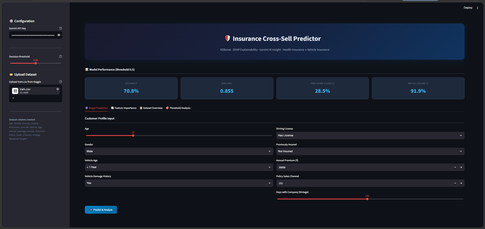
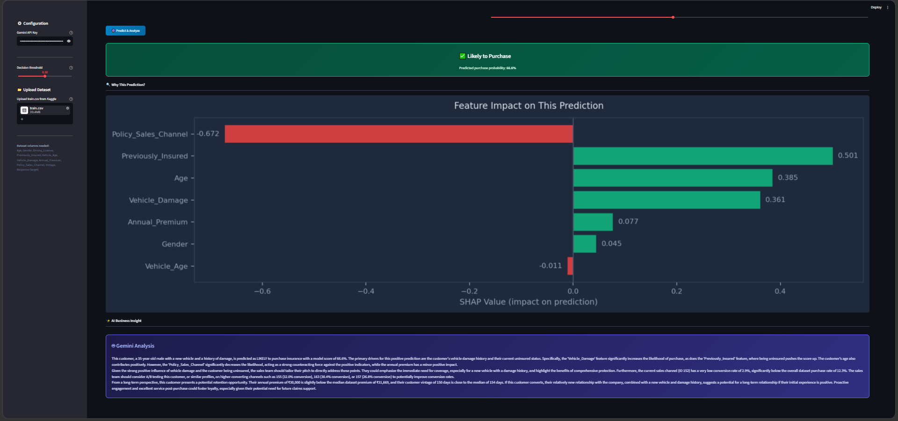
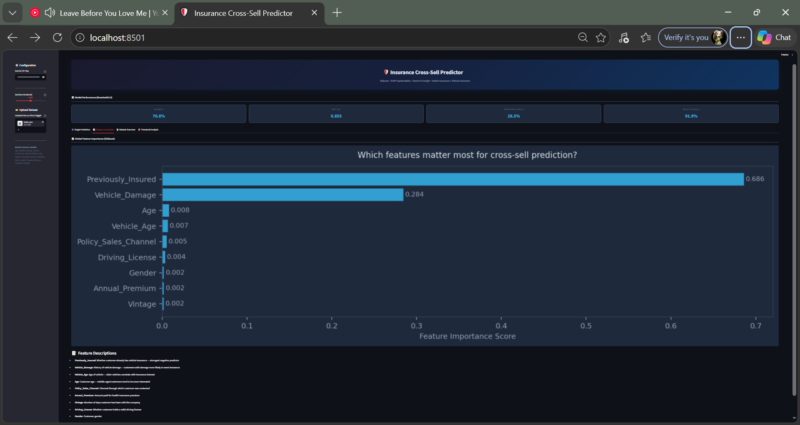
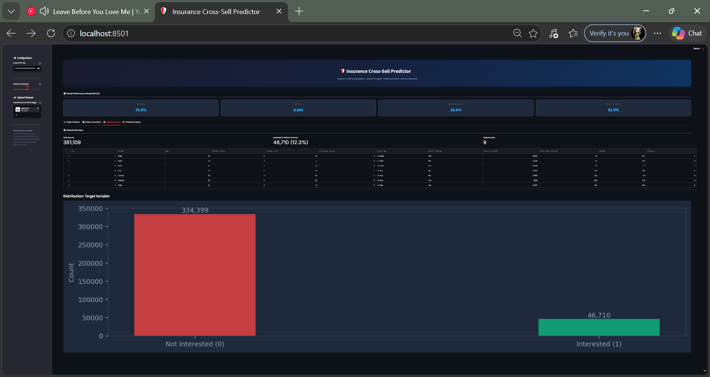
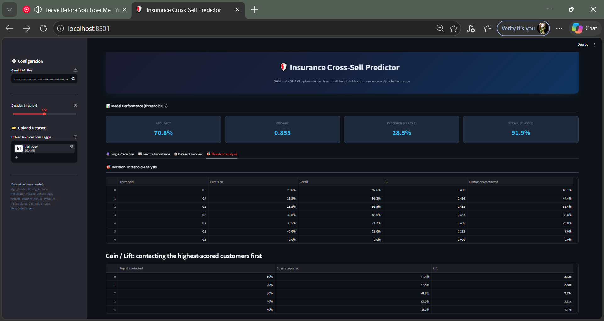

# 🛡️ Insurance Cross-Sell Prediction App

An upgraded ML pipeline for predicting whether health insurance customers will purchase vehicle insurance — built with **XGBoost**, **SHAP explainability**, a decision-threshold analysis, and **Gemini AI insights**, in a Streamlit app.

## 🚀 Features

| Feature | Description |
|---|---|
| **XGBoost Model** | Gradient boosting with class weighting (scale_pos_weight) for the imbalanced target; evaluated with ROC-AUC |
| **SHAP Explainability** | Shows which features push each customer's prediction up or down |
| **Threshold Analysis** | Precision, recall and F1 at different decision thresholds, plus a gain/lift table |
| **Gemini AI Insight** | Business recommendations via the Gemini API. The prompt includes dataset reference values (medians, channel conversion rates) so statements are tied to numbers |
| **Interactive UI** | Streamlit app with a customer profile form and an adjustable decision threshold |

## 📸 App Screenshots

### Dashboard & Input


### Prediction Result & AI Insight  


### Feature Importance


### Dataset Overview


### Threshold Analysis


## 📊 Dataset

Download from Kaggle: [Health Insurance Cross Sell Prediction](https://www.kaggle.com/datasets/anmolkumar/health-insurance-cross-sell-prediction)

381,109 customer records, of which 12.3% bought vehicle insurance. Upload `train.csv` directly in the app sidebar.

## 🛠️ Tech Stack

- **Python** · **Streamlit** · **XGBoost** · **SHAP**
- **Scikit-learn** · **Pandas** · **NumPy** · **Matplotlib**
- **Google Gemini API** (REST)

## ⚙️ Installation & Run

```bash
# Clone this repo
git clone https://github.com/rizkiamandaa/Insurance-Cross-Sell-Predictor
cd Insurance-Cross-Sell-Predictor

# Install dependencies
pip install -r requirements.txt

# Run the app
streamlit run app.py
```

## 🔑 Gemini API Key

Get your free API key at [aistudio.google.com](https://aistudio.google.com) and enter it in the sidebar.

## 📈 Model Performance

Stratified 80/20 train/test split, decision threshold 0.5.

| Metric | Score |
|---|---|
| Accuracy | ~70.8% |
| ROC-AUC | ~0.855 |
| Precision (Class 1) | ~28.5% |
| Recall (Class 1) | ~91.9% |

The positive class is only 12.3% of the data, so a random list of customers would have about 12% precision. Class weighting gives high recall at the default 0.5 threshold and lower precision, which is why accuracy is only 70.8%. The trade-off can be tuned with the threshold (next section).

## 🎯 Threshold Analysis

Predicted probabilities from a class-weighted model are not calibrated, so the score should be read as a ranking score, not a literal probability. Choose the threshold from the table according to the cost of contacting a customer.

| **Threshold** | **Precision** | **Recall** | **F1** | **Customers Contacted** |
|---|---|---|---|---|
| 0.3 | 25.6% | 97.6% | 0.406 | 46.7% |
| 0.4 | 26.5% | 96.2% | 0.416 | 44.4% |
| 0.5 | 28.5% | 91.9% | 0.435 | 39.4% |
| 0.6 | 30.8% | 85.0% | 0.452 | 33.8% |
| 0.7 | 33.5% | 71.2% | 0.456 | 26.0% |
| 0.8 | 40.0% | 23.0% | 0.292 | 7.0% |

**Gain / Lift** : contacting the highest-scored customers first.

| **Top % Contacted** | **Buyers Captured** | **Lift** |
|---|---|---|
| 10% | 31.3% | 3.13x |
| 20% | 57.5% | 2.88x |
| 30% | 78.8% | 2.63x |
| 40% | 92.5% | 2.31x |
| 50% | 98.7% | 1.97x |

**⚠️ Limitations**
- One train/test split and fixed hyperparameters; no cross-validation or tuning.
- Scores are uncalibrated (see above), so very high thresholds (0.9) return no customers.
- Policy_Sales_Channel is an anonymized code. The app reports each channel's conversion rate but not what the channel is, and the Gemini text describes associations in the data, not causes.
- Gemini output depends on the model and prompt and should be read as a suggestion, not a finding.

---

Built by **Rizki Amanda Putri** · [GitHub](https://github.com/rizkiamandaa) · [LinkedIn](https://linkedin.com/in/rizkiamandaa)
